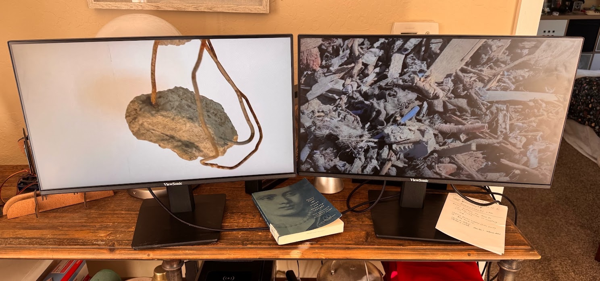
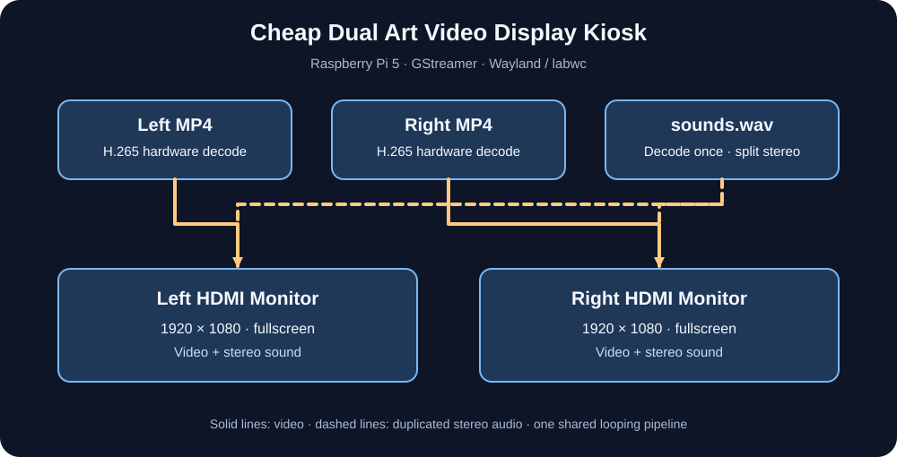

# Cheap Dual Art Video Display Kiosk, <$200

A low-cost Raspberry Pi 5 playback system for a two-monitor video artwork. Two independent, synchronized **H.265/HEVC** videos fill their respective monitors while a separate stereo WAV soundtrack plays through **both HDMI audio outputs**. The system loops continuously without player controls, title bars, or a visible mouse pointer.

> **Project status:** This repository documents a configuration reported working on the installation Raspberry Pi in October 2026. It is tailored to that Pi's monitor arrangement, ALSA device numbering, and labwc configuration; it is not a universal plug-and-play player.





## Installation photograph

The photograph above shows a working two-monitor display running separate synchronized videos. It is included as a real-world demonstration of the setup; the example artwork and soundtrack are not distributed with this repository.

### Create test videos with FFmpeg

Before using your own artwork, you can generate **two matching 10-second H.265 test videos** and a **10-second stereo WAV soundtrack**. This verifies that both screens, both HDMI audio outputs, and synchronized looping work. These commands use [FFmpeg](https://ffmpeg.org/) (sometimes mistakenly called “ffmjpeg”). Run them on a computer with FFmpeg installed; encoding H.265 is generally faster on a desktop or laptop than on the Pi.

```bash
mkdir -p ~/Videos/dual-art-kiosk
cd ~/Videos/dual-art-kiosk

# Left: moving test pattern with a clock-like timestamp.
ffmpeg -y -f lavfi -i "testsrc2=size=1920x1080:rate=30" \
  -t 10 -an -c:v libx265 -preset fast -pix_fmt yuv420p \
  -tag:v hvc1 -movflags +faststart TestLeft_H265.mp4

# Right: SMPTE color bars; same dimensions, frame rate, and duration.
ffmpeg -y -f lavfi -i "smptebars=size=1920x1080:rate=30" \
  -t 10 -an -c:v libx265 -preset fast -pix_fmt yuv420p \
  -tag:v hvc1 -movflags +faststart TestRight_H265.mp4

# Stereo test tone: 48 kHz, 16-bit PCM WAV, 10 seconds.
ffmpeg -y -f lavfi -i "sine=frequency=440:sample_rate=48000:duration=10" \
  -af "pan=stereo|c0=c0|c1=c0" -c:a pcm_s16le sounds.wav
```

The player expects these **exact filenames** inside `~/Videos/dual-art-kiosk/` on the Raspberry Pi. If you generate them on your Mac, copy all three files to the Pi with `scp` (adjust the host as necessary):

```bash
scp ~/Videos/dual-art-kiosk/{TestLeft_H265.mp4,TestRight_H265.mp4,sounds.wav} \
  pi@raspberrypi:~/Videos/dual-art-kiosk/
```

These test files are **not included in the repository**. They are generated locally and will be overwritten if you use the same names for your finished artwork. Once the tests pass, replace them with your actual media, keeping the two videos the same frame rate and duration as each other and matching the soundtrack duration.

## Budget scope

Target: under $200 including both displays. We bought two 25 inch monitors for $50 each, the Raspberry Pie 5 2g for $50, and SD card, cables and power adaptor. We recommend getting two of the same monitors for video animation and resolution.

## Hardware and software links

All links below point to the manufacturers' or projects' official pages. Hardware pricing and availability vary; the monitors in this build were purchased **secondhand for $50 each**, not at a current advertised retail price.

| Product or software | Official link | Role in the kiosk |
|---|---|---|
| Raspberry Pi 5 | [Raspberry Pi 5 product page](https://www.raspberrypi.com/products/raspberry-pi-5/) | Drives two independent HDMI displays. |
| ViewSonic monitors (VA2448-FHD as identified on the installation) | [ViewSonic monitor catalog](https://www.viewsonic.com/global/products/lcd/) | Two secondhand 1080p displays, **$50 each**. The precise VA2448-FHD model page could not be verified; this links to the official catalog rather than a different model. |
| Raspberry Pi OS | [Official Raspberry Pi OS download](https://www.raspberrypi.com/software/) | Operating system and desktop. |
| Raspberry Pi Imager | [Official imaging utility](https://www.raspberrypi.com/software/) | Writes the OS to a microSD card. |
| Debian 13 (Trixie) | [Debian Trixie](https://www.debian.org/releases/trixie/) | OS distribution underlying the reference Pi installation. |
| Wayland | [Wayland project](https://wayland.freedesktop.org/) | Display protocol. |
| labwc | [labwc project](https://github.com/labwc/labwc) | Wayland window compositor and window-placement rules. |
| Python 3 | [Python](https://www.python.org/) | Runs the kiosk application. |
| PyGObject | [PyGObject](https://pygobject.gnome.org/) | Python bindings for GTK and GStreamer. |
| GTK 3 | [GTK 3 documentation](https://docs.gtk.org/gtk3/) | Fullscreen video windows and hidden cursor. |
| GStreamer | [GStreamer](https://gstreamer.freedesktop.org/) | Video decoding, audio routing, and looping. |
| GStreamer GTK OpenGL sink | [gtkglsink documentation](https://gstreamer.freedesktop.org/documentation/gtk/gtkglsink.html) | Hardware-accelerated video presentation. |
| OpenGL | [OpenGL](https://www.khronos.org/opengl/) | GPU video transformation. |
| ALSA | [ALSA project](https://www.alsa-project.org/) | Audio to both HDMI outputs. |
| FFmpeg / ffprobe | [FFmpeg](https://ffmpeg.org/) · [ffprobe documentation](https://ffmpeg.org/ffprobe.html) | Check media formats and duration. |
| wlr-randr | [wlr-randr project](https://git.sr.ht/~emersion/wlr-randr) | Inspect display layout and output names. |
| H.265 / HEVC | [ITU-T H.265 specification](https://www.itu.int/rec/T-REC-H.265) | Video codec used by both movie files. |
| HDMI | [HDMI specification organization](https://www.hdmi.org/) | Carries video and audio to both monitors. |
| microSD storage | [Raspberry Pi setup guide](https://www.raspberrypi.com/documentation/computers/getting-started.html) | Boot and media storage; select suitable capacity. |
| Raspberry Pi power supply | [Raspberry Pi power supplies](https://www.raspberrypi.com/products/27w-power-supply/) | Power for the Pi 5. |

## Hardware

- Raspberry Pi 5 running Raspberry Pi OS **Debian 13 / Trixie**, Wayland **labwc** desktop
- Two ViewSonic VA2448-FHD monitors, each **1920 × 1080**, approximately **59.94 Hz**
- Two HDMI connections from the Pi, with monitor speakers/audio available over both
- Keyboard/mouse and SSH access for initial configuration

The reference layout places **Art Video 1** on `HDMI-A-2` at desktop position `(0, 0)` and **Art Video 2** on `HDMI-A-1` at `(1920, 0)`. The physical HDMI connector, output name, and ALSA device index need not match on other systems.

## Media files

The player expects these files on the Pi, **outside this source repository**:

```text
~/Videos/dual-art-kiosk/
├── TestLeft_H265.mp4
├── TestRight_H265.mp4
└── sounds.wav
```

The two test videos are 1920 × 1080 HEVC at 30 fps, **6,055 frames**, **201.833 seconds**. The soundtrack is a separate WAV file. For a clean loop, export the WAV to the same duration and make the beginning/end musically compatible. Media is excluded by `.gitignore` because the artwork and soundtrack may have separate copyright/permission requirements.

**Media transfer from a Mac** (replace `pi@raspberrypi` with your Pi login/hostname):

```bash
scp ~/Downloads/sounds.wav pi@raspberrypi:~/Videos/dual-art-kiosk/
```

If the Pi hostname does not resolve, use the Pi's IP address instead. For other installations, update the `BASE`, `LEFT`, `RIGHT`, and `AUDIO` constants at the top of `dual_art_kiosk.py`.

## Software dependencies

The packages below are from [Raspberry Pi OS](https://www.raspberrypi.com/software/) and provide [PyGObject](https://pygobject.gnome.org/), [GTK 3](https://docs.gtk.org/gtk3/), [GStreamer](https://gstreamer.freedesktop.org/), [ALSA](https://www.alsa-project.org/), and [FFmpeg](https://ffmpeg.org/).

Install the Raspberry Pi OS packages that provide Python GObject bindings, GTK 3, GStreamer, the relevant GStreamer plugin families, ALSA, and tools for inspection:

```bash
sudo apt update
sudo apt install -y \
  python3-gi gir1.2-gtk-3.0 gir1.2-gstreamer-1.0 \
  gstreamer1.0-tools gstreamer1.0-plugins-base \
  gstreamer1.0-plugins-good gstreamer1.0-plugins-bad \
  gstreamer1.0-gl gstreamer1.0-alsa \
  ffmpeg
```

On Raspberry Pi OS, the `v4l2slh265dec` hardware decoder also depends on the kernel/driver and installed plugin build. **Check element availability before running:**

```bash
gst-inspect-1.0 v4l2slh265dec
gst-inspect-1.0 gtkglsink
gst-inspect-1.0 gltransformation
gst-inspect-1.0 alsasink
```

The [Python](https://www.python.org/) program requires an **active graphical Wayland session**. SSH by itself does not start the compositor.

## Run

The repository includes **`run.sh`** (a Bash shell script, not `run.py`). It launches the Python program `dual_art_kiosk.py` inside the existing Wayland desktop session. Here is the **complete source of `run.sh`**:

```bash
#!/usr/bin/env bash
set -euo pipefail
export XDG_RUNTIME_DIR="${XDG_RUNTIME_DIR:-/run/user/$(id -u)}"
export WAYLAND_DISPLAY="${WAYLAND_DISPLAY:-wayland-0}"
exec /usr/bin/python3 -u "$(dirname "$(readlink -f "$0")")/dual_art_kiosk.py"
```

Copy `dual_art_kiosk.py` and `run.sh` from this repository into the **same directory** on the Raspberry Pi (for example, `~/`), then make the launcher executable and start it:

```bash
chmod +x ~/run.sh
~/run.sh
```

The launcher sets `XDG_RUNTIME_DIR` and `WAYLAND_DISPLAY` defaults. The equivalent direct command, if the files are in `~/`, is:

```bash
XDG_RUNTIME_DIR=/run/user/$(id -u) WAYLAND_DISPLAY=wayland-0 \
  /usr/bin/python3 -u ~/dual_art_kiosk.py
```

Stop the current player with `Ctrl+C` in its terminal, or before restarting use:

```bash
pkill -f '[p]ython3.*dual_art_kiosk.py' || true
~/run.sh
```

**Only one instance should run at a time.** The HDMI ALSA devices may be held exclusively by the previous player.

## Window positioning / labwc

The program creates windows with exact titles:

- `Art Video 1`
- `Art Video 2`

The installation's existing `~/.config/labwc/rc.xml` window rules identify these titles and move the first window to `(0,0)` and the second to `(1920,0)` before fullscreen is applied. **Those compositor rules are necessary**: Wayland applications cannot reliably position themselves by absolute desktop coordinates. If both windows fullscreen on the same monitor, inspect the labwc rules and output arrangement rather than changing the video files.

After editing labwc configuration, reload it with:

```bash
pkill -HUP -x labwc
```

Use [`wlr-randr`](https://git.sr.ht/~emersion/wlr-randr) (if installed) to check monitor names, modes, and placement. The exact labwc XML depends on the installed version and existing configuration, so this repository intentionally does not overwrite the working `rc.xml`.

## How playback works

```text
TestLeft_H265.mp4             TestRight_H265.mp4
        |                              |
      qtdemux                        qtdemux
        |                              |
      h265parse                      h265parse
        |                              |
      v4l2slh265dec                 v4l2slh265dec
        |                              |
      queue                          queue
        |                              |
      glupload                       glupload
        |                              |
      glcolorconvert                 glcolorconvert
        |                              |
      gltransformation               gltransformation
        |                              |
      gtkglsink                      gtkglsink
        |                              |
  Left fullscreen                 Right fullscreen
       window                         window

sounds.wav
    |
  decodebin
    |
 audioconvert
    |
 audioresample
    |
   tee
   / \
 queue queue
  |     |
alsasink alsasink
  |     |
plughw:0,0 plughw:1,0
```

All three sources share one GStreamer pipeline. An end-of-stream message triggers a **flushing seek to time zero** for the entire pipeline, restarting both videos and the WAV together. The sound is decoded once, then split into two synchronized ALSA output branches. Both monitors receive the same full stereo soundtrack (not left/right channels split between monitors).

### Bottom-edge artifact mitigation

The installation showed a visual artifact in the bottom ~5 video rows. The current, working player applies a small GPU transformation using `gltransformation` (`scale-y = 1080/1075` and `translation-y = 5/1080`) to move the bottom edge out of view. This is an installation-specific workaround rather than a general-purpose pixel-accurate crop; exact behavior depends on the OpenGL/GStreamer plugin version. Original media is not modified.

### Hidden mouse cursor

GTK assigns a `BLANK_CURSOR` to each video window. The pointer remains available outside the artwork windows for maintenance.

## Troubleshooting

| Symptom | Check |
|---|---|
| `Cannot create GStreamer element: v4l2slh265dec` | Decoder plugin, Raspberry Pi OS image, kernel and hardware codec support. |
| `not-linked` from WAV parsing | This version uses `filesrc → decodebin` for WAV; confirm the current script is running and inspect `ffprobe sounds.wav`. |
| No sound | Run `aplay -l` to inspect ALSA devices; `plughw:0,0` and `plughw:1,0` are specific to the installation. |
| Audio device busy | Stop the previous player process before launching another. |
| Both videos on one screen | Check `labwc` title-based placement rules and monitor geometry. |
| Title bars / unused borders | Verify fullscreen window placement and monitor mode; the source videos are 16:9. |
| Stutter | Confirm the `v4l2slh265dec` hardware decoder is used, not a CPU-only H.264 path. |
| Loop gap | Check video and WAV durations with `ffprobe`; make sure the audio itself loops smoothly. |
| Player starts via SSH but no windows | Confirm the desktop Wayland session is running and `WAYLAND_DISPLAY` matches it. |

Useful diagnostics:

```bash
ffprobe -v error -show_entries format=duration -of default=noprint_wrappers=1 \
  ~/Videos/dual-art-kiosk/sounds.wav
aplay -l
wlr-randr
```

## Autostart: launch automatically after power-on

The goal is for the Pi to boot into the **labwc desktop**, place the two fullscreen windows on their assigned monitors, and play indefinitely without a keyboard. The steps below are a **recommended deployment configuration**; the documented player was tested interactively, but this autostart configuration has **not yet been verified on the reference Pi**.

### 1. Enable desktop autologin

Run `sudo raspi-config` on the Pi. Under **System Options → Boot / Auto Login**, select the **desktop autologin** option (the exact menu labels can vary by Raspberry Pi OS release). Reboot once and confirm the labwc graphical desktop opens without a password prompt. **Do not configure console-only autologin:** the GTK windows require a running graphical session.

### 2. Create a systemd user service

The examples assume the repository's `dual_art_kiosk.py` and `run.sh` are in `/home/pi/dual-art-kiosk/` and the desktop login is `pi`. **Replace `/home/pi` and `pi` with your actual username and path**; the original reference installation used a different login.

```bash
mkdir -p ~/.config/systemd/user
nano ~/.config/systemd/user/dual-art-kiosk.service
```

Paste:

```ini
[Unit]
Description=Dual Art Video Display Kiosk
StartLimitIntervalSec=0

[Service]
Type=simple
WorkingDirectory=/home/pi/dual-art-kiosk
Environment=XDG_RUNTIME_DIR=%t
Environment=WAYLAND_DISPLAY=wayland-0
ExecStart=/home/pi/dual-art-kiosk/run.sh
Restart=on-failure
RestartSec=5

[Install]
WantedBy=default.target
```

The launcher must be executable:

```bash
chmod +x /home/pi/dual-art-kiosk/run.sh
systemctl --user daemon-reload
```

**Important:** Do **not** enable this service under `default.target` with `systemctl --user enable` when using the labwc autostart method below: that could start it **before Wayland is ready**. The `[Install]` stanza is included for completeness, but the service is deliberately started by labwc.

### 3. Start the service when labwc is ready

Edit the existing `~/.config/labwc/autostart` file (create it if missing) and **append** this line without deleting other desktop startup commands:

```bash
systemctl --user start dual-art-kiosk.service &
```

For example:

```bash
mkdir -p ~/.config/labwc
nano ~/.config/labwc/autostart
```

The trailing `&` ensures the compositor's startup is not held up by the command. On the next graphical login, labwc starts the user service, and systemd supervises the player. If the player crashes, systemd restarts it after five seconds.

### 4. Test, inspect logs, and stop

After rebooting, check:

```bash
systemctl --user status dual-art-kiosk.service
journalctl --user -u dual-art-kiosk.service -b --no-pager -n 80
```

To restart after a code change:

```bash
systemctl --user restart dual-art-kiosk.service
```

To stop it for maintenance:

```bash
systemctl --user stop dual-art-kiosk.service
```

To disable automatic launch, remove or comment out the `systemctl --user start dual-art-kiosk.service &` line from `~/.config/labwc/autostart`. Avoid running `~/run.sh` manually while the service is running: two instances may compete for the HDMI audio devices. If the system's Wayland socket is not `wayland-0`, update the `WAYLAND_DISPLAY` setting in the service.

**Cold-boot checklist:** confirm both screens wake up, the left and right artworks appear on their intended outputs, audio is audible from both monitors, no cursor/title bar is visible, and a complete loop restarts correctly. Test more than one power cycle before installing unattended.

## What did not work (and why)

These are lessons from the **reference installation**, not a claim that the alternatives never work on other hardware.

| Attempt / symptom | What happened | Working approach |
|---|---|---|
| Two 1080p **H.264 software-decoded** videos | Playback was too slow or stuttered under the tested configuration. | Convert both videos to **H.265/HEVC** and use the Pi's `v4l2slh265dec` hardware decoder. |
| `autoaudiosink` / PipeWire audio routing | The desktop exposed only a **Dummy Output**, so audio did not reach the monitor speakers. | Use `alsasink` with the actual HDMI ALSA device names (`plughw:0,0` and `plughw:1,0` on the reference Pi). |
| Running a second copy while the first kept playing after SSH disconnected | The old process retained the audio devices, preventing the new instance from using them. | Stop the first player before starting another; for unattended use, control the **one** systemd user service. |
| Reading `sounds.wav` through a manually assembled `wavparse → decodebin` path | GStreamer stopped with `gst_wavparse_loop(): streaming stopped, reason not-linked (-1)`. | Connect `filesrc → decodebin` and let GStreamer discover and decode the WAV container. |
| Ordinary decorated GTK windows | Title bars and unused bands appeared around the images. | Remove decorations, request fullscreen, and position each window through labwc rules. |
| A few corrupted-looking rows along the bottom of each video | A visible artifact remained at the bottom edge. | Use a small `gltransformation` vertical adjustment to conceal approximately five rows without re-encoding the artwork. |
| Default visible mouse cursor | The pointer remained on top of the artwork. | Assign GTK's `BLANK_CURSOR` to both video windows. |
| Assuming an SSH login creates a graphical session | A shell over SSH does not create a Wayland compositor. | Enable **desktop autologin** and start the player from labwc's `autostart`. |

## Helpful FFmpeg and ffprobe commands

The tools are **[FFmpeg](https://ffmpeg.org/)** (media conversion) and **[ffprobe](https://ffmpeg.org/ffprobe.html)** (inspection). The project uses **FFmpeg**, not “ffmjpeg”; the video files are **H.265/HEVC**, not MJPEG. Commands below are reproducible examples based on the media preparation and diagnostic tasks used during development. Exact original encoding flags were not recorded, so the conversion recipes are **recommended examples**, not a verbatim transcript of past commands.

Install tools on Raspberry Pi OS:

```bash
sudo apt update && sudo apt install -y ffmpeg
```

### Inspect a video's codec, dimensions, frame rate, and duration

```bash
ffprobe -v error -select_streams v:0 \
  -show_entries stream=codec_name,width,height,r_frame_rate,nb_frames,duration \
  -of default=noprint_wrappers=1 TestLeft_H265.mp4
```

### Check all streams in a file (including audio)

```bash
ffprobe -hide_banner -i TestLeft.mp4
ffprobe -hide_banner -i sounds.wav
```

### Convert a source video to H.265 while keeping 1080p at 30 fps

Run this on a **Mac or other sufficiently fast computer**, rather than expecting the Pi to encode quickly. The example drops embedded audio because the kiosk uses a separate soundtrack. `libx265` must be present in your FFmpeg build.

```bash
ffmpeg -i TestLeft.mp4 \
  -map 0:v:0 -an -c:v libx265 -preset medium -crf 23 \
  -pix_fmt yuv420p -r 30 -tag:v hvc1 \
  TestLeft_H265.mp4

ffmpeg -i TestRight.mp4 \
  -map 0:v:0 -an -c:v libx265 -preset medium -crf 23 \
  -pix_fmt yuv420p -r 30 -tag:v hvc1 \
  TestRight_H265.mp4
```

`-crf 23` is a starting point: lower values generally produce higher quality and larger files. If the original movies are already 30 fps, consider omitting `-r 30` to avoid unnecessary frame duplication or dropping.

### Confirm the two videos have matching frame counts

```bash
ffprobe -v error -select_streams v:0 -count_frames \
  -show_entries stream=nb_read_frames -of csv=p=0 TestLeft_H265.mp4
ffprobe -v error -select_streams v:0 -count_frames \
  -show_entries stream=nb_read_frames -of csv=p=0 TestRight_H265.mp4
```

In the reference installation, **both videos have 6,055 frames at 30 fps**, yielding approximately **201.833 seconds**.

### Extract the original audio as an uncompressed stereo WAV

```bash
ffmpeg -i TestLeft.mp4 -vn \
  -c:a pcm_s16le -ar 48000 -ac 2 sounds.wav
```

To convert an already-edited soundtrack from another supported audio format, replace `TestLeft.mp4` with that audio file. If the input contains no audio, this command cannot create a soundtrack.

### Trim or pad a WAV to match the video duration

```bash
ffmpeg -i sounds-original.wav \
  -af 'apad,atrim=duration=201.833333,asetpts=PTS-STARTPTS' \
  -c:a pcm_s16le -ar 48000 -ac 2 sounds.wav
```

This makes the **file duration** match the videos, but does **not** guarantee a musically seamless transition at the loop boundary. Edit/crossfade the sound in an audio editor when necessary.

### Check soundtrack duration

```bash
ffprobe -v error -show_entries format=duration \
  -of default=noprint_wrappers=1 sounds.wav
```

### Extract a still image to inspect video-edge artifacts

```bash
ffmpeg -ss 00:00:10 -i TestLeft_H265.mp4 \
  -frames:v 1 frame-at-10s.png
```

Compare the extracted frame with what appears on the Pi's screen. If the bottom artifact is absent from the PNG but visible on the monitor, it points toward the **decode/render/display path**, not necessarily the encoded file.

### Inspect the last few seconds for loop transitions

```bash
ffmpeg -sseof -3 -i TestLeft_H265.mp4 -t 3 \
  -c copy last-three-seconds.mp4
```

This extracts a short clip for inspection without re-encoding; stream-copy cuts may start at a nearby keyframe rather than the exact requested timestamp.

## Files in this repository

```text
README.md                  Project documentation
LICENSE                    Full GNU GPL version 3 license text
dual_art_kiosk.py          Dual-video / dual-HDMI-audio playback program
run.sh                     Shell launcher
.gitignore                 Excludes artwork and generated files
docs/architecture.svg      System architecture illustration
docs/images/README.md      Photography checklist
```

## Credits and rights

- **Playback implementation:** [Raspberry Pi OS](https://www.raspberrypi.com/software/), [GTK 3](https://docs.gtk.org/gtk3/), [GStreamer](https://gstreamer.freedesktop.org/), [labwc](https://github.com/labwc/labwc), [ALSA](https://www.alsa-project.org/).
- **Artwork shown in the photograph:** belongs to its creator and is not included in the repository.

**Software license:** [GNU General Public License version 3 (GPL-3.0-only)](LICENSE). The full license text is included in the repository.
